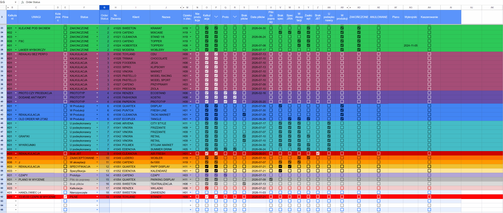
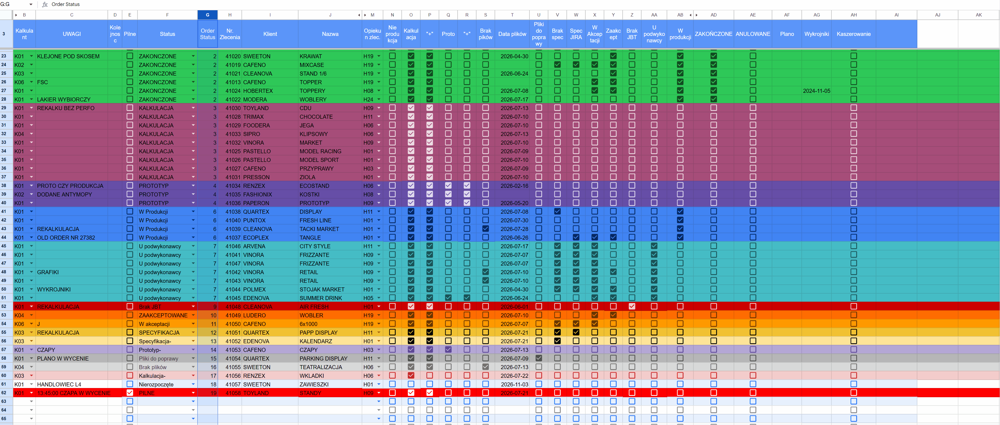
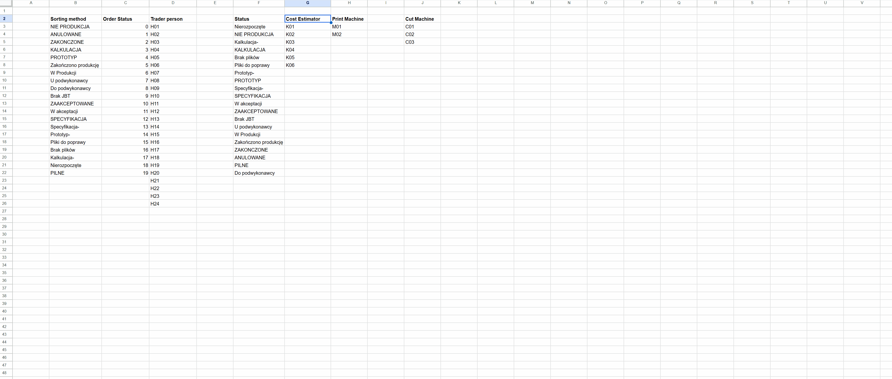

# Production Order Tracker

**Excel-based production workflow tracking | 3,000+ real-world orders | 3.5 years in daily use**

An independently designed and maintained spreadsheet system used to coordinate production orders in a large-scale industrial printing environment. Built around a clear, color-coded overview of order progress, it helped the team quickly identify the current stage of each job and supported daily morning production calls.

> **[Explore the interactive Google Sheets demo](https://docs.google.com/spreadsheets/d/1xxfDRInHzeXz1_QtrW6rwseWfV2iTubzAiGT-sLsgLE/edit?usp=sharing)**
>
> The public demo contains **synthetic example data**. The 3,000+ order figure and 3.5-year period describe use of the original system in production, **not** the number of rows in this demo.

## Business context

Coordinating many concurrent print-production jobs requires an immediate answer to a practical question: **What stage is each order at today?** The tracker brought job details, assigned people, production checkpoints, and status information into a single working view. Its visual organization made it useful during morning operational calls, when the status of individual jobs needed to be established quickly.

## Core functionality

- **Status-driven color coding:** conditional formatting highlights entire rows according to the current production stage, making exceptions and active work easy to spot.
- **Checkbox-based workflow tracking:** checkboxes record production milestones and support quick progress updates.
- **Order prioritization and sorting:** sorting the **Order Status** column **A → Z** groups records by a numeric status order; completed and cancelled jobs appear near the top, while ongoing stages appear later in the list.
- **Controlled dropdown values:** the **Cost Estimator**, **Trader / Sales Representative**, and **Status** fields use reference lists maintained in a second worksheet, supporting consistent data entry.
- **Daily operational visibility:** a single view of jobs, ownership, checkpoints, dates, and progress supported production coordination and morning status meetings.

## Feature walkthrough

### 1. Sorting by order status

Use **Order Status → Sort A to Z** to group orders by their workflow stage. The numeric sort key is based on the status mapping in the reference worksheet.

### 2. Production status and row colors

Changing an order's status updates its visual classification. The color of the row provides a fast, at-a-glance indication of the production stage.

### 3. Reference data and dropdowns

Cost estimators, sales representatives, and statuses are selected from centrally maintained lists in a separate worksheet.

## How to try the demo

1. Open the **[Google Sheets demo](https://docs.google.com/spreadsheets/d/1xxfDRInHzeXz1_QtrW6rwseWfV2iTubzAiGT-sLsgLE/edit?usp=sharing)**.
2. Inspect the **Order List** and its color-coded statuses and production checkpoints.
3. Change a permitted checkbox or status dropdown and observe the resulting visual state.
4. Sort **Order Status** from **A to Z** to group orders by production stage.
5. Open the reference worksheet to inspect the lists used for dropdown validation.

**Note:** This is a shared, editable demonstration. Changes made by visitors may be visible to others; the demo owner maintains a separate backup. Please avoid deleting columns, formulas, or worksheets.

## Tools and techniques

**Microsoft Excel · Google Sheets (demo) · Conditional Formatting · Data Validation · Checkboxes · Filtering and Sorting · Reference Tables · Production Workflow Management**

## Outcomes

- Supported the coordination of **more than 3,000 production orders** over **3.5 years**.
- Provided a quick visual overview of each order's production stage.
- Served as a key reference during daily morning production calls.
- Reduced the effort required to locate and communicate the current status of individual jobs.

## Data privacy

The public demonstration uses fictitious client names, order identifiers, project descriptions, and staff codes. It is intended to illustrate the workflow, not to disclose operational or customer information from the original production environment.

## Project scope

This repository documents an original spreadsheet-based operational tool. It is **not** presented as a software application or a source-code project. The linked Google Sheets file is a demonstration of the Excel workflow, and the media files illustrate its interface and functionality.

