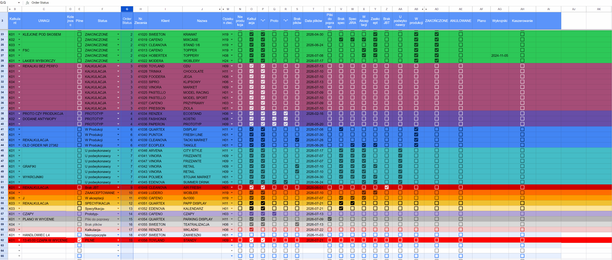
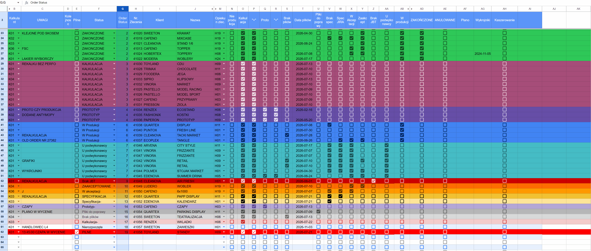
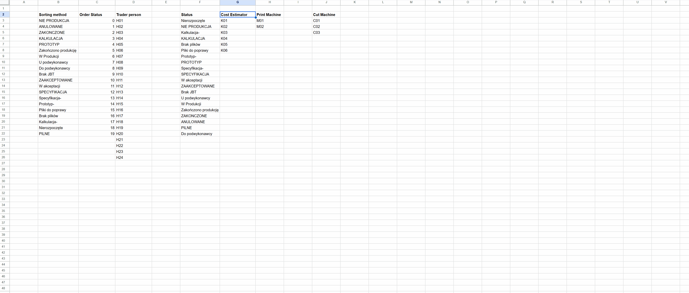

# Production Order Tracker

**Autorski system monitorowania zleceń produkcyjnych w Excelu | Ponad 3000 rzeczywistych zleceń | 3,5 roku codziennego użytkowania**

**[English](README.md) | Polski**

Zaprojektowany i rozwijany przeze mnie arkusz do koordynowania zleceń w dużej drukarni przemysłowej. Dzięki czytelnemu oznaczaniu etapów produkcji kolorami i sortowaniu zleceń system pozwalał szybko ustalić, na jakim etapie znajduje się każde zamówienie. Był jednym z podstawowych narzędzi podczas codziennych porannych spotkań operacyjnych.

> **[Otwórz interaktywne demo w Google Sheets](https://docs.google.com/spreadsheets/d/1xxfDRInHzeXz1_QtrW6rwseWfV2iTubzAiGT-sLsgLE/edit?usp=sharing)**
>
> Publiczna demonstracja zawiera **wyłącznie fikcyjne dane przykładowe**. Ponad 3000 zleceń i 3,5 roku użytkowania odnoszą się do oryginalnego arkusza wykorzystywanego w produkcji, a nie do liczby rekordów w wersji demo.

## Kontekst biznesowy

Przy równoległej realizacji wielu zleceń produkcyjnych kluczowe było szybkie uzyskanie odpowiedzi na pytanie: **na jakim etapie znajduje się dziś każde zlecenie?** Arkusz łączył w jednym miejscu informacje o zamówieniach, osobach odpowiedzialnych, etapach przygotowania i realizacji oraz terminach. Kolorowe oznaczenia i uporządkowana lista ułatwiały bieżącą koordynację i komunikację podczas porannych spotkań produkcyjnych.

## Najważniejsze funkcjonalności

- **Kolory zależne od statusu:** formatowanie warunkowe automatycznie koloruje całe wiersze zgodnie z etapem realizacji zlecenia.
- **Checkboxy do śledzenia postępu:** pola wyboru umożliwiają oznaczanie wykonanych czynności i etapów produkcyjnych.
- **Sortowanie według etapów:** sortowanie kolumny **Order Status** **od A do Z** wykorzystuje numeryczną kolejność statusów z arkusza referencyjnego. Zlecenia zakończone i anulowane trafiają na początek listy, a bieżące etapy znajdują się dalej.
- **Listy rozwijane:** pola **Cost Estimator** (kalkulant), **Trader / Sales Representative** (handlowiec) i **Status** korzystają ze słowników utrzymywanych w drugim arkuszu, co zapewnia spójność wpisów.
- **Codzienny przegląd produkcji:** jeden widok pozwalał sprawdzać właścicieli zleceń, daty, statusy i wykonanie poszczególnych czynności.

## Prezentacja funkcjonalności

### 1. Sortowanie według statusu zlecenia

W kolumnie **Order Status** wybierz **Sortuj od A do Z**. Rekordy zostaną pogrupowane według etapów realizacji na podstawie numerycznej kolejności statusów.

### 2. Status produkcji i kolorowanie wierszy

Zmiana statusu zlecenia wpływa na jego wizualne oznaczenie. Kolor całego wiersza pozwala natychmiast rozpoznać etap produkcji.

### 3. Dane referencyjne i listy wyboru

Kalkulant, handlowiec i status są wybierani z list opartych na danych przechowywanych w drugim arkuszu.

## Jak przetestować demo?

1. Otwórz **[arkusz Google Sheets](https://docs.google.com/spreadsheets/d/1xxfDRInHzeXz1_QtrW6rwseWfV2iTubzAiGT-sLsgLE/edit?usp=sharing)**.
2. Przejrzyj listę zleceń, kolory statusów i checkboxy poszczególnych etapów.
3. Zmień wybrany checkbox lub status i sprawdź zmianę oznaczenia wiersza.
4. Posortuj kolumnę **Order Status** **od A do Z**.
5. Otwórz drugi arkusz, aby zobaczyć słowniki wykorzystywane przez listy rozwijane.

**Uwaga:** to współdzielona wersja demonstracyjna z możliwością edycji. Zmiany jednego odwiedzającego mogą być widoczne dla pozostałych. Proszę nie usuwać kolumn, formuł ani arkuszy.

## Technologie i techniki

**Microsoft Excel · Google Sheets (demo) · Formatowanie warunkowe · Sprawdzanie poprawności danych · Checkboxy · Filtrowanie i sortowanie · Tabele referencyjne · Koordynacja produkcji**

## Efekty biznesowe

- Wsparcie obsługi **ponad 3000 zleceń produkcyjnych** w ciągu **3,5 roku**.
- Szybki, wizualny przegląd etapu realizacji każdego zlecenia.
- Podstawowe źródło informacji podczas codziennych porannych spotkań operacyjnych.
- Łatwiejsze wyszukiwanie i przekazywanie aktualnych informacji o postępie prac.

## Bezpieczeństwo danych

Wersja publiczna zawiera fikcyjne nazwy klientów, numery zleceń, opisy projektów i oznaczenia pracowników. Jej celem jest zaprezentowanie mechanizmu działania, bez ujawniania danych klientów i informacji operacyjnych z rzeczywistego środowiska produkcyjnego.

## Zakres repozytorium

Repozytorium dokumentuje **autorskie narzędzie operacyjne oparte na arkuszu kalkulacyjnym**. Nie jest przedstawiane jako aplikacja programistyczna ani repozytorium kodu źródłowego. Google Sheets stanowi interaktywną demonstrację rozwiązania opracowanego pierwotnie w Excelu, a załączone materiały ilustrują jego wygląd i funkcje.
